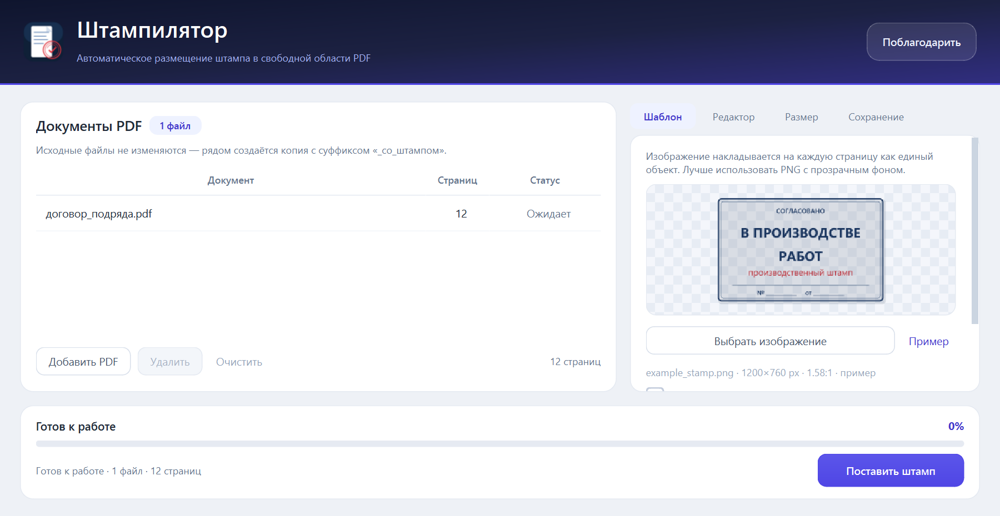
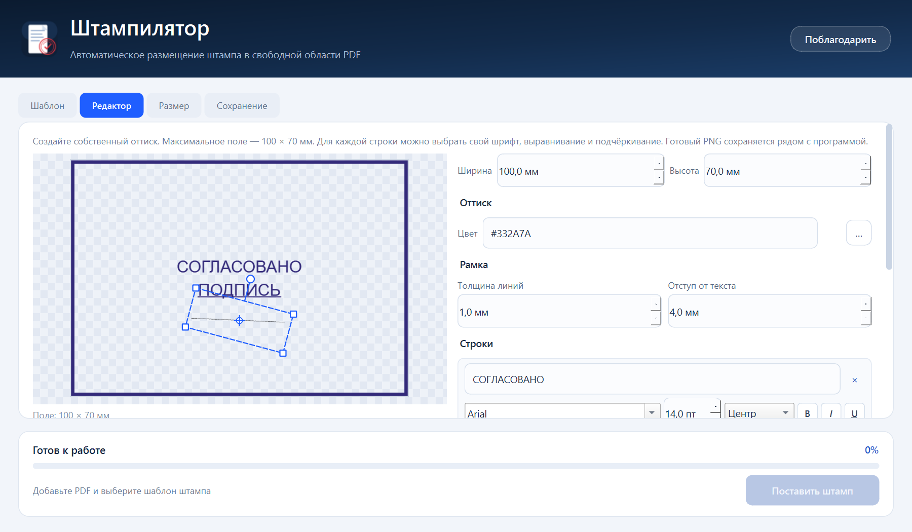

# Штампилятор

Windows-приложение для автоматической простановки изображения штампа на каждой
странице PDF. Программа анализирует видимое содержимое листа, ищет свободное
место, начиная с правого нижнего угла, и сохраняет результат в новый PDF.
Исходные документы не изменяются.




## Возможности

- выбор одного или нескольких PDF-файлов (кнопкой или перетаскиванием);
- выбор шаблона штампа — PNG, JPG, BMP, WebP, TIFF;
- встроенный редактор собственного штампа: поле до 100 × 70 мм, цвет оттиска,
  рамка, отступ, строки текста, индивидуальные шрифт/выравнивание/подчёркивание
  каждой строки и рукописная подпись с ручками; готовый PNG сохраняется рядом
  с программой и сразу загружается как шаблон;
- настройка ширины и высоты штампа в миллиметрах с сохранением пропорций;
- раздельные отступы от левого, правого, верхнего и нижнего края листа;
- настройка зазора до содержимого;
- текстовая строка под штампом (Arial, до 30 символов, по центру) с отступом,
  высотой шрифта и цветом; блок расположен на вкладке «Шаблон»;
- режим частичного перекрытия с выбором точки минимального наложения;
- исключение области основной надписи ГОСТ 2.104 (справа снизу на чертежах,
  в нижней полосе текстовых документов);
- удаление белого фона у JPG/PNG со сплошной белой подложкой;
- индикатор хода обработки с номером файла и страницы, возможность отмены;
- итоговый отчёт по страницам, в том числе о страницах, где свободного места
  полностью не нашлось;
- выбор папки сохранения; существующие файлы не перезаписываются;
- автоматическое сохранение последнего шаблона, размеров, отступов и прочих
  настроек (файл `%APPDATA%\Shtampilyator\settings.ini`);


## Редактор штампа

Вкладка **«Редактор»** находится рядом с «Шаблон». Возможности:

- при переходе в редактор левая карточка «Документы PDF» скрывается — рабочее
  поле занимает всё окно;
- поле штампа — до **100 × 70 мм** (ширину и высоту можно уменьшать);
- цвет оттиска — по умолчанию сине-фиолетовый чернильный `#332A7A`;
- толщина линий рамки и отступ рамки от текста;
- одна или несколько текстовых строк, добавление и удаление строк;
- у каждой строки свой шрифт, размер, жирность, курсив, подчёркивание и
  выравнивание по горизонтали;
- вставка изображения рукописной подписи: перемещение мышью или центральной
  ручкой, изменение размера угловыми ручками и поворот круглой ручкой;
- предпросмотр на шахматном фоне;
- сохранение PNG (вместе с подписью) в папку с `Штампилятор.exe` и
  автоматическая загрузка сохранённого штампа как шаблона.

Для подписи лучше использовать PNG с прозрачным фоном: JPG с белым фоном
даст белый прямоугольник. Подпись перетаскивается мышью или центральной
ручкой, размер меняется четырьмя угловыми ручками, поворот — круглой ручкой
над рамкой.

Файл получает имя вида `stamp_20261021_113712.png`. В исходном запуске
используется корень проекта, в собранном приложении — папка с EXE.



## Как работает поиск места

Для каждой страницы:

1. Видимая страница рендерится в градациях серого и превращается в маску
   реально нарисованных пикселей (текст, линии, таблицы, изображения).
   Геометрические габариты векторных путей не используются: рамка листа или
   длинная линия иначе ошибочно занимали бы весь чертёж.
2. Для положений штампа проверяется количество краски под прямоугольником.
   Свободным считается место без краски; зазор до содержимого учитывается
   отдельной проверкой расширенной области.
3. Перебираются положения штампа внутри листа с учётом четырёх отступов.
   Свободные положения упорядочиваются по близости к правому нижнему углу;
   выбирается ближайшее.
4. Если полностью свободного места нет, поведение зависит от галочки
   **«Разрешить частичное перекрытие содержимого»**:
   - галочка снята — страница остаётся без штампа, в отчёте появляется
     предупреждение;
   - галочка установлена — выбирается точка с минимальной долей перекрытия.
5. Опция **«Игнорировать область основной надписи»** дополнительно исключает
   зону ГОСТ 2.104: 185×55 мм в правом нижнем углу чертежа либо нижнюю полосу
   высотой 40 мм у текстового документа. Зона учитывается, только если в ней
   есть содержимое; штамп в неё не ставится даже при разрешённом перекрытии.
6. Если штамп больше доступной области, он пропорционально уменьшается; это
   также отмечается в отчёте.

Учитываются поворот страницы (`/Rotate`) и смещённый `/CropBox`, поэтому штамп
остаётся вертикальным и попадает в нужное место на необычно оформленных листах.

## Быстрый запуск

Готовый комплект: `dist\Штампилятор-1.2.1-win64.zip` (Windows x64, около 86 МБ).
Распакуйте архив **целиком** в любую папку (после распаковки — около 200 МБ)
и запустите `Штампилятор\Штампилятор.exe`. Установка не требуется. Рядом с EXE
должна оставаться папка `_internal` — это библиотеки приложения, их нельзя
удалять или переносить отдельно.

Приложение поставляется портативной папкой, а не одним EXE, специально:
single-file-сборка PyInstaller распаковывает библиотеки во временный каталог
`%TEMP%`, и на машинах с ограниченным доступом к нему появляется ошибка
`Could not create temporary directory`. Портативная папка работает без такой
распаковки.

EXE не подписан цифровой подписью, поэтому SmartScreen может показать
предупреждение при первом запуске.

Порядок работы:

1. Нажмите **«Добавить PDF»** или перетащите файлы в список.
2. На вкладке **«Шаблон»** выберите изображение. Кнопка **«Пример»** загружает
   демонстрационный штамп из `assets/example_stamp.png`. Там же находится блок
   «Добавить текстовую строку»: текст до 30 символов, отступ, высота шрифта
   и цвет. Рядом с вкладкой «Шаблон» есть вкладка **«Редактор»** — в ней можно
   нарисовать собственный штамп.
3. На вкладке **«Размер»** задайте ширину/высоту, отступы слева/справа/сверху/
   снизу и зазор до содержимого. При включённой галочке «Сохранять пропорции
   шаблона» высота пересчитывается автоматически.
4. На вкладке **«Сохранение»** выберите, куда положить результаты.
5. Нажмите **«Поставить штамп»**. Ход обработки отображается в нижней панели;
   кнопка **«Отменить»** останавливает работу после текущей страницы.
6. После завершения откроется отчёт со статусами «Готово» или «Ошибка».
   Кнопка **«Открыть папку»** покажет результаты в Проводнике.

Результаты получают суффикс `_со_штампом`; при совпадении имени добавляется
номер. Исходный файл остаётся неизменным. Последние настройки (шаблон, размеры,
отступы, текст и папка сохранения) сохраняются автоматически и восстанавливаются
при следующем запуске.

### Форматы цвета текста

Поле цвета принимает `#000000`, `#f00`, `red`, `rgb(0, 128, 0)`,
`rgba(0, 0, 255, 0.5)`, `0, 0, 255`, `255 0 0`, `0xFF0000`,
`hsl(120, 100%, 25%)`, а также русские названия: `чёрный`, `белый`, `красный`
и другие. Рядом с полем показывается образец цвета; кнопка «…» открывает
системный выбор цвета.

## Шаблон штампа

Лучший вариант — PNG с прозрачным фоном. Размер изображения в пикселях влияет
только на качество: на листе штамп занимает размер, заданный в миллиметрах.
Изображение автоматически ограничивается по длинной стороне 2600 px, чтобы PDF
не разрастался.

Для JPG с белым фоном включите **«Сделать белый фон шаблона прозрачным»**.
Пиксели, у которых все каналы светлее 244, станут прозрачными; учитывайте, что
белые элементы внутри самого штампа тоже исчезнут.

## Сборка из исходников

Требования: Windows 10/11 x64, Python 3.11+ (проверено на 3.14), интернет для
установки пакетов.

```powershell
python -m pip install -r requirements.txt
.\build.cmd
```

`build.cmd` запускает `build.ps1` с политикой выполнения `Bypass`, поэтому
подходит и для машин, где обычные `.ps1`-файлы заблокированы. Если политика
разрешает скрипты, можно запускать и напрямую:

```powershell
.\build.ps1
```

Скрипт:

1. проверяет зависимости;
2. запускает тесты;
3. очищает `build` и содержимое `dist`;
4. собирает портативную папку `dist\Штампилятор` (PyInstaller, без консоли);
5. кладёт рядом с EXE файлы `LICENSE`, `THIRD_PARTY_NOTICES.md`, `licenses/`
   и `SOURCE.txt`;
6. создаёт `Штампилятор-1.2.1-source.zip` с исходным кодом и кладёт его
   рядом с EXE и папкой `_internal`;
7. упаковывает всё в `dist\Штампилятор-1.2.1-win64.zip`.

Если тесты нужно пропустить:

```powershell
.\build.cmd -SkipTests
```

Сборка вручную:

```powershell
python -m PyInstaller --noconfirm --clean Shtampilyator.spec
```

PyInstaller использует `assets/` и `version_info.txt`; итоговый файл —
`dist\Штампилятор\Штампилятор.exe`, архив — `dist\Штампилятор-1.2.1-win64.zip`.
При ручной сборке не забудьте отдельно скопировать лицензии и упаковать
исходники: это делает `build.ps1`.

## Тесты

```powershell
python -m unittest discover -s tests -v
```

Тесты создают PDF-примеры в `.tmp/tests` и проверяют:

- поиск свободного места и сохранение текста;
- раздельные отступы слева/справа/сверху/снизу;
- рамка листа не блокирует свободное место внутри;
- страница без свободного места: пропуск без галочки и минимальное
  перекрытие с галочкой;
- исключение основной надписи на чертеже и в текстовом документе;
- текстовую строку Arial под штампом (центрирование, лимит 30 символов);
- разбор цветов в HTML/CSS, rgb/rgba, hsl, числовых и именованных форматах;
- поворот страницы и ненулевой `/CropBox`;
- ориентацию штампа после поворота;
- прозрачность белого фона;
- уменьшение слишком большого штампа;
- отмену обработки;
- защищённые паролем PDF.

## Структура проекта

```text
main.py                 точка входа
pdfstamp/core.py        анализ PDF, поиск места, вставка штампа
pdfstamp/gui.py         окно, фоновая обработка, отчёт
pdfstamp/stamp_editor.py редактор собственного штампа
pdfstamp/theme.py       оформление Qt
assets/                 иконка, демонстрационный шаблон и QR-код
tools/make_samples.py   генератор PDF-примеров
tools/make_assets.py    генератор иконки и шаблона
tests/test_core.py      тесты ядра
tests/test_editor.py    тесты редактора штампа
docs/screenshot.png     скриншот для документации
docs/editor.png         скриншот редактора
Shtampilyator.spec           конфигурация PyInstaller
build.cmd               запуск сборки в обход execution policy
build.ps1               сборка EXE
```

## Если приложение не запускается

- **`Could not create temporary directory`.** Используйте портативную сборку из
  `dist\Штампилятор-1.2.1-win64.zip`: она не распаковывается во временный каталог.
  Старые однофайловые сборки для этой машины не подходят.
- **`Не найден Qt6Core.dll` или похожая ошибка.** Распакуйте архив полностью;
  `Штампилятор.exe` должен лежать рядом с папкой `_internal`.
- **SmartScreen.** Нажмите «Подробнее» → «Выполнить в любом случае». EXE не
  подписан; это ожидаемое предупреждение.
- **Журнал ошибок.** `%LOCALAPPDATA%\Shtampilyator\app.log`. Если каталог
  недоступен, приложение пробует `%TEMP%` и папку программы, а при полном
  запрете записи всё равно запускается — просто без файла журнала.

## Ограничения

- **Сканы и сплошные изображения.** Если страница целиком является растровым
  сканом, свободного места на ней нет. Без галочки частичного перекрытия
  страница останется без штампа; с галочкой штамп будет поставлен в точке
  минимального наложения. Это отражается в отчёте.
- **Электронная подпись.** Любое изменение PDF делает существующую подпись
  недействительной. Для подписанных документов создавайте копию и подписывайте
  её заново.
- **PDF с паролем** не обрабатываются. Снимите защиту или сохраните копию без
  пароля.
- **PDF/A и особые формы.** Вставка изображения может нарушить соответствие
  PDF/A; поля форм и закладки сохраняются, но сложные динамические формы стоит
  проверить в целевом просмотрщике.
- **Векторный текст** не растрируется: текст, закладки и ссылки остаются
  доступными. Штамп вставляется отдельным изображением поверх содержимого.

## Лицензия

«Штампилятор» распространяется под **GNU Affero General Public License
version 3 (AGPL-3.0-only)**. Полный текст — в файле [`LICENSE`](LICENSE).

В комплект входят:

- `LICENSE` — текст AGPL-3.0;
- `THIRD_PARTY_NOTICES.md` — сведения о сторонних компонентах;
- `licenses/` — тексты лицензий зависимостей;
- `Штампилятор-1.2.1-source.zip` — исходный код, сборочные файлы и лицензии.

Архив исходников лежит **рядом с `Штампилятор.exe` и папкой `_internal`**.
Его можно передавать вместе с приложением или публиковать отдельной ссылкой.
Сторонние компоненты: PyMuPDF/MuPDF — AGPL-3.0; PySide6/Qt — LGPL-3.0;
Python — PSF-2.0; NumPy и lxml — BSD-3-Clause; Pillow — HPND;
charset-normalizer и FontTools — MIT; PyInstaller — GPL-2.0 с исключением.
